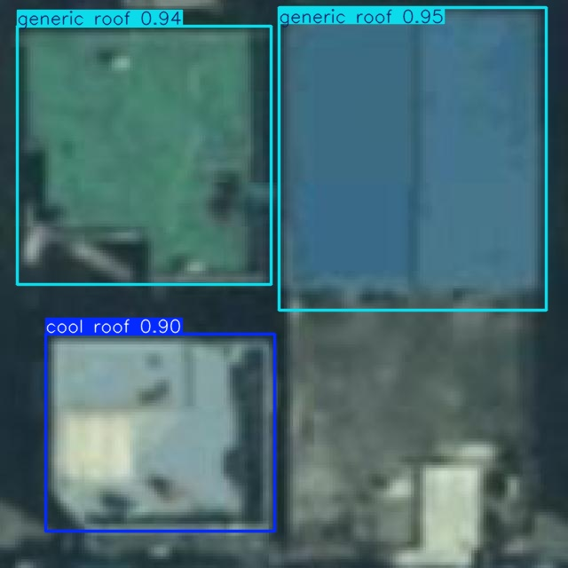
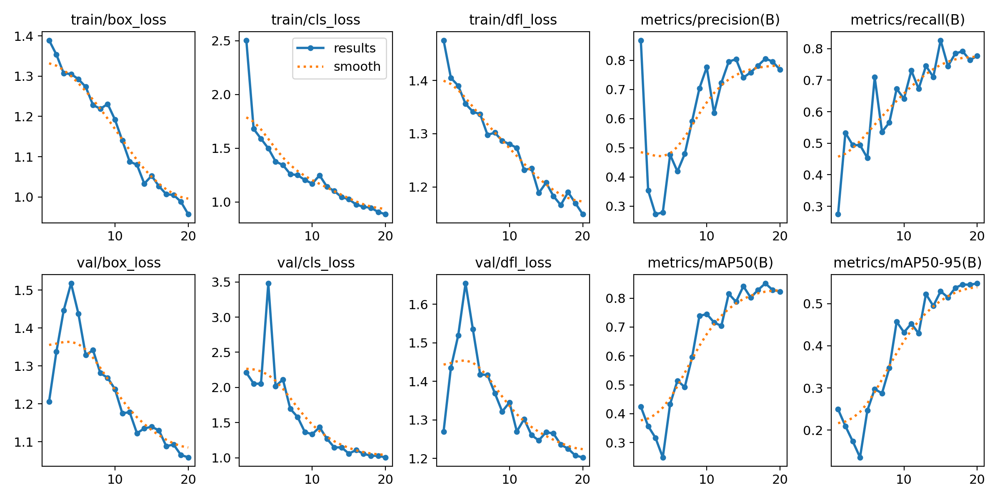
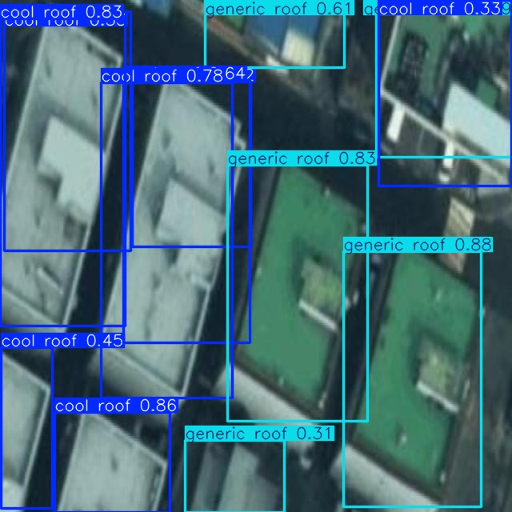
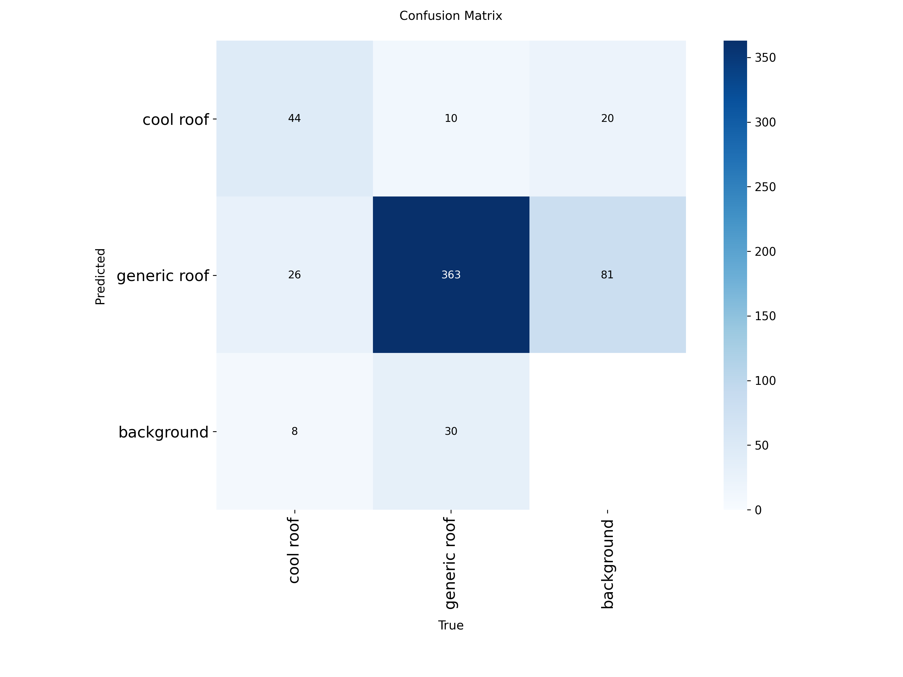

# cool-roof-detection

**항공·위성 영상에서 쿨루프 시공 대상 지붕을 검출하는 YOLOv8 객체 검출 파이프라인**

데이터 수집·병합·라벨링부터 학습·추론까지 전 과정을 구현하고, 코랩과 로컬
어디서든 동일하게 재현되도록 설계했습니다.

<!-- 대표 이미지: results/sample_predictions/good_case.jpg -->

*직접 수집한 위성 이미지 추론 결과 — 초록·파랑·흰색 지붕이 공존하는 장면에서
쿨루프(흰색 차열 도장)만 정확히 구분 검출. 파란 지붕을 쿨루프로 오인하지 않아
단순 밝기 휴리스틱이 아닌 재질·색상 기반 구분임을 보여준다.*

---

## 1. Results

검증셋(이미지 71장 · 객체 481개) 기준 최종 성능:

| Class | Instances | Precision | Recall | **mAP@50** | mAP@50-95 |
|---|---|---|---|---|---|
| **all** | 481 | 0.776 | 0.779 | **0.823** | 0.548 |
| cool roof | 78 | 0.739 | 0.653 | 0.734 | 0.486 |
| generic roof | 403 | 0.813 | 0.904 | 0.912 | 0.610 |

**재현성 검증** — 본 저장소의 파이프라인은 2024.04 원 실험을 재현하도록
설계되었으며(seed 2024), 데이터 분할이 원 실험과 동일함(검증 481개 객체,
클래스 분포 78:403 일치)을 확인했습니다.

| 실행 | 환경 | epochs | mAP@50 |
|---|---|---|---|
| 원 실험 (2024.04) | Colab · Ultralytics 8.1.47 | 20 | 0.821 |
| 본 저장소 재현 | Windows 로컬 · Ultralytics 8.4.117 | 20 | **0.823** |

환경과 라이브러리 버전이 다름에도 mAP@50은 +0.002 차이로 수렴했으며,
**mAP@50-95는 전체·클래스별 모두 원 실험과 동일하게(0.548 / 0.486 / 0.610)**
재현되었습니다.

<!-- 학습 곡선 -->

*10 epochs 시점 대비 20 epochs에서 소수 클래스(cool roof) 성능이 지속 상승 — 7. Error Analysis 참고*

---

## 2. Problem Definition

쿨루프(cool roof)는 건물 옥상에 태양열 반사 도료를 시공해 냉방 부하를 줄이는
도시 열섬 대응 사업입니다. 시공 대상 건물 선별은 항공사진을 사람이 일일이
확인하는 방식으로 이루어지는데, 본 프로젝트는 이를 객체 검출 모델로
자동화하는 것을 목표로 합니다.

- **입력**: 항공·위성 시점(top-down)의 지붕 이미지
- **출력**: 지붕 객체의 위치(바운딩박스) + 클래스(쿨루프 시공 / 일반 지붕)
- **과제 특성**: 소규모 데이터셋, 클래스 불균형(약 1:5), 회전된 건물 배치

## 3. Dataset

| 구성 | 규모 | 출처·용도 |
|---|---|---|
| 기본 제공 이미지 | 200장 (라벨 객체 1,500개+) | KT AIVLE School 제공 · train/val |
| Roboflow 외부 데이터셋 | 139장 | 병합하여 학습 데이터 1.7배 확장 |
| 직접 수집 위성 이미지 | 15장 | 위성지도 캡처 → Roboflow 라벨링 · 추론 검증(test) |
| **합계 (train/val)** | **339장 (train 268 / val 71)** | 8:2 분할, seed=2024 고정 |

- 클래스: `0: cool roof`, `1: generic roof` — 검증셋 기준 78:403 (약 1:5 불균형)
- 라벨 포맷: YOLO txt (외부 데이터셋은 YOLOv8-OBB 포맷으로 수급 후 통합)
- 원본 데이터셋은 교육과정 제공 자료로 **저장소에 포함하지 않습니다**
  (→ 하단 고지 참고)

## 4. Pipeline

```
데이터 수집·병합 → 압축 해제 → YOLO 폴더 구조화 → 스플릿(8:2, seed 고정)
→ YAML 생성(절대경로 path 고정) → YOLOv8n 전이학습 → best.pt 추론
```

각 단계는 노트북에서 경로 상수(`BASE` / `DATA_SRC` / `DATASETS`)만 참조하며,
실행 환경(Colab/로컬)은 시작 시 한 번 자동 감지되어 이후 셀에는 분기가
없습니다. 스플릿 단계에는 이미지–라벨 쌍 정합 검증(assert)을 두어 경로
오류가 조용히 통과하는 것을 차단했습니다.

## 5. Training Setup

| 항목 | 값 | 선택 근거 |
|---|---|---|
| 모델 | YOLOv8n (3.0M params, 8.2 GFLOPs) | CPU 학습 제약 하 최소 용량 + COCO 전이학습 |
| 입력 크기 | 640×640 | 위성 캡처 원본 비율 유지 |
| batch / epochs | 16 / 20 | early stopping(patience=5) 병행 |
| 재현성 | seed=2024 | 원 실험과 동일 분할 보장 |
| 학습 환경 | AMD Ryzen 5 5600X (CPU) | 약 1시간 내외 |

## 6. Error Analysis

**① 클래스 불균형에 따른 소수 클래스 성능 격차**
cool roof는 검증셋 객체 수가 generic roof의 약 1/5(78 vs 403)이며,
mAP@50 기준 약 0.18(0.734 vs 0.912)의 성능 격차가 발생했습니다. 시공 대상 선별이라는
목적상 소수 클래스 검출력이 곧 서비스 품질이므로 핵심 개선 대상입니다.

**② 학습량에 대한 클래스별 민감도 (epochs 실험)**
10 epochs 중간 실험에서 generic roof는 이미 mAP@50 0.901로 수렴한 반면,
cool roof는 0.693에 머물렀고 20 epochs에서 0.734까지 상승했습니다
(+0.041 vs generic +0.011 — 약 4배의 민감도 차이).
다수 클래스는 적은 학습량으로 충분하지만 소수 클래스는 학습량에 민감함을
확인했으며, 이는 불균형 데이터에서 조기 종료 기준을 전체 지표가 아닌
소수 클래스 지표로 설정해야 할 근거가 됩니다.

**③ 회전 밀집 구역의 중복 검출 — 실패 사례**


*대각선으로 회전 배치된 건물 밀집 구역 — 축 정렬 박스(AABB)가 인접 지붕을
침범하며 동일 건물에 중복 검출(cool roof 0.93/0.82/0.27/0.33)이 발생했다.
회전 객체의 AABB는 서로 다른 위치의 예측 박스 간 IoU가 낮게 계산되어 NMS를
통과하기 때문으로, 7장 Limitations #2(OBB 전환)의 실증 근거다.*

<!-- confusion matrix -->


## 7. Limitations & Future Work

**1. 클래스 불균형 대응** — 소수 클래스 중심 추가 수집, copy-paste 계열
증강, 클래스 가중치 조정을 우선 개선안으로 봅니다.

**2. 축 정렬 박스(AABB)의 구조적 한계 — OBB 전환** — 항공 이미지 속
건물은 다양한 방향으로 회전되어 있어, 축 정렬 바운딩박스는 배경을 과도하게
포함하고 인접 지붕 간 중첩을 유발합니다. 회전 객체에 적합한
YOLOv8-OBB(Oriented Bounding Box)로 라벨 체계를 전환하는 것이 다음
실험입니다 (6장 ③ 실패 사례 참고).

**3. 데이터 다양성 부족** — 학습 데이터가 특정 지역·시점 위성지도에 편중되어
해상도·계절·촬영 조건 변화에 대한 일반화는 검증되지 않았습니다. 국토지리정보원
정사영상 등 공공 항공영상으로 검증 도메인을 확장하는 것이 목표입니다.

**4. 단일 hold-out 검증의 분산 미측정** — 1회 분할 성능은 분할 운에 따라
변동될 수 있어, k-fold 교차검증으로 성능 분산을 함께 보고하고자 합니다.

## 8. How to Run

```bash
git clone https://github.com/Siz777/cool-roof-detection.git
cd cool-roof-detection
pip install -r requirements.txt
```

**API 키 설정** (Roboflow 데이터셋 수급용)
- **로컬**: `.env.example`을 `.env`로 복사 후 본인 키 입력
- **Colab**: 좌측 🔑 Secrets에 `ROBOFLOW_API_KEY` 등록 후 노트북 액세스 허용

노트북(`notebooks/train_pipeline.ipynb`)을 위에서 아래로 실행하면
데이터 준비 → 학습 → 추론이 완주됩니다. 실행 환경은 자동 감지되며,
학습 없이 추론만 재실행할 경우 '추론' 섹션은 저장된 `best.pt`를
자동 탐색해 독립 실행됩니다.

> 참고: 원 실험은 Ultralytics 8.1.47, 본 저장소 검증은 8.4.117에서
> 수행되었습니다. 버전 간 학습 결과는 소수점 단위에서 다를 수 있습니다.

## 9. Repository Structure

```
cool-roof-detection/
├── README.md
├── requirements.txt
├── .env.example
├── notebooks/
│   └── train_pipeline.ipynb      # 전 과정 파이프라인 (출력 포함)
└── results/
    ├── metrics.md                # 최종 성능 표
    ├── results.png               # 학습 곡선
    ├── confusion_matrix.png
    └── sample_predictions/
        ├── good_case.jpg         # 3색 지붕 공존 장면의 정검출 (대표 이미지)
        └── failure_case.jpg      # 회전 밀집 구역의 중복 검출 (실패 분석)
```

---

*본 저장소는 2024.04 KT AIVLE School 미니프로젝트를 베이스라인으로,
2026년에 외부 데이터 병합·위성 이미지 직접 수집·Colab→로컬 환경 이식·
API 키 보안 처리·재현성 검증(2년 시차, 상이한 환경에서 mAP 동일 재현)을
더해 재구성한 결과물입니다. 교육과정 제공 데이터셋은 저작권 보호를 위해
포함하지 않습니다.*
